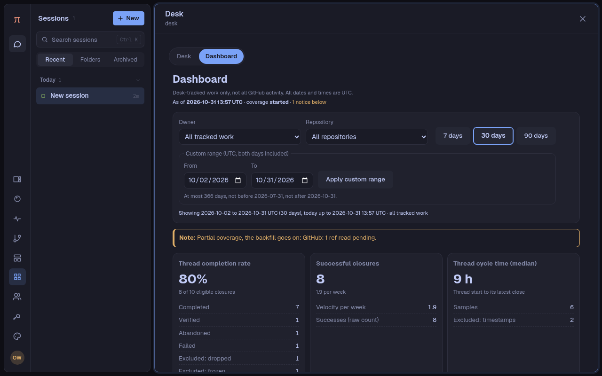
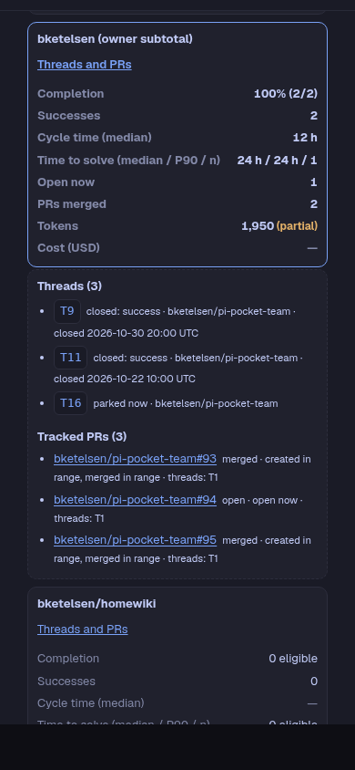

# The Desk's Dashboard

The Desk page has 2 views: **Desk**, the operational inbox (the default each time the page opens), and **Dashboard**, the
numbers of Desk-tracked work for 1 range and 1 scope. Both are owner-only. The Dashboard only reads: it has no control
that changes a thread, and opening it starts no collection. It calls 1 route, `GET /api/x/desk/dashboard`, which reads 2
stored documents and nothing else (no GitHub call, no transcript read, no commit, no task).

The screenshots show the fixture of `desk-dashboard-fixture.ts` in the isolated preview (`npm run preview-desk`).

## The screen

- **Controls.** Owner (all tracked work, or 1 GitHub owner), repository (all, or 1 repository; it sets its owner), the
  presets 7, 30 (default) and 90 days, and a custom range (both days included, UTC). The owner and repository lists come
  from `choices` in the answer: every owner and repository with an attributed record, whatever the scope, so a choice
  never disappears when a scope is picked. All scopes share 1 range. The selections live in memory only (no browser
  storage); they stay while the module stays loaded, also across a switch to Desk and back.
- **Status line.** The snapshot time (`asOf`, UTC), the coverage status, and the count of notices.
- **Notices**, each a separate line with its own words: refresh failed (the last good numbers stay, dimmed, with their
  time), range refused (the route's 400 message; the last good numbers stay), collection not started, a stale source, a
  failed source, a source never read, usage unavailable, partial coverage (the backfill goes on: pending refs and
  sessions), no tracked work in the scope (the zeros are true zeros), and no eligible closures.
- **Usage unavailable.** Tokens and cost are unknown ("—" on the cards, in the "Apart" lines, and in every table row,
  the scope total included) when usage was never collected, or when its only read failed (no good read yet). This occurs
  after the first collector pass, which fixes the boundary before any usage step. A partial usage source, and a failed
  one after a good read, keep their collected facts, with a notice that they can be low.
- **Cards**, in this order: thread completion rate, successful closures and velocity, thread cycle time, time to solve,
  current workload ("now"), tracked PRs, dated tokens, reported model cost (USD). Each card has "How is this counted?".
- **Daily trend.** The successful closures by UTC day, as bars (each with its text for screen readers), with a summary
  line and a "Daily table". The bars are 1 grid column for each day, so 1 to 366 days fit any width: the gap between
  bars is 2 px up to 31 days, 1 px up to 92 days, and 0 above that.
- **Projects.** 1 row for each repository, under its owner's subtotal row, and at the all-work scope 1 unattributed row;
  the scope total is the last row. Each column sorts (unknown values last in both directions). On a phone each row is a
  small card, with a "Sort by" control. There is no drill-down link: the operational Desk has no repository filter.
- **Coverage and definitions.** The coverage status, the recovery boundary, the first day a range can start, the source
  table (status, last good read, last check, error), the progress counts, the population rule, the time rules, and the
  limitations that the answer lists.

"—" means unknown (a screen reader says "unknown"); "0" is a real zero. In the project table, "0 eligible" means no
eligible closure (completion) or no resolved issue (time to solve).

The view reads once when it opens, then every 60 seconds while it is mounted and the browser tab is visible. A tab that
comes back to view reads at once when the last read is older than that. Switching to Desk, closing the page, and the
module's dispose stop the timer and abort a read in flight; an answer that comes after that changes nothing.

## Time

- All dates are UTC days. A range starts at 00:00 UTC of its first day (inclusive) and ends at 00:00 UTC after its last
  day (exclusive). A range that includes today ends at the snapshot time (`partialToday`).
- A range is 1 to 366 days. It must not start before the recovery boundary's day, and must not end after today. A preset
  never starts before the boundary's day. When the boundary falls inside the first day, events count only from the
  boundary on (`partial-first-day`).
- Outcomes are the latest known. A reopened thread leaves its range until it closes again; its latest closure counts
  once. Earlier numbers can change: this is not an immutable ledger.

## Population and attribution

- **Delivery threads.** Every delegated thread (also one whose delegation failed before a session started), and every
  found, seeded, asked, or plan thread that has a session or an attributable PR. A plan thread with task threads is a
  coordinator: its task threads count, it does not. Ask-only threads, and other threads with no session and no PR, do
  not count. Threads that left `x.desk.threads` keep their facts (`gone`).
- **Repository.** A thread belongs to its explicit `thread.repo` only. A PR belongs to the repository of its ref. An issue
  belongs to its own repository, also when its resolving PR is in another one. A session belongs to the repository of its
  explicit Desk links; a subagent conversation takes its nearest linked ancestor's. A session whose links name 2 or more
  repositories is unattributed, as a conflict.
- **Scopes.** All tracked work includes unattributed records. An owner or a repository includes only the records
  attributed to it. So project rows alone can sum lower than the total. Every rate, median and P90 of an owner row and of
  the total comes from its own raw records, never from the rows above it.

## Metrics

- **Thread completion rate.** Delivery threads whose latest closure falls in the range and that are still closed. Success:
  `why=done` with outcome `completed` or `verified`. Denominator: the successes, plus `why=done` with outcome `abandoned`,
  plus `why=failed`. Excluded and counted apart: `why=dropped` (checked first), outcome `frozen`, and no outcome
  (unknown, as on old records). A closure with no valid time is undated: it is in no range. With a denominator of 0 the
  card says "No eligible closures", never 0%.
- **Successful closures and velocity.** The successes above, and successes per week of the elapsed range: the range's
  effective start (the boundary when it is later) to its end (the snapshot time when it includes today). The daily trend
  counts the same closures.
- **Thread cycle time (median).** From the thread's `startedAt` to its latest close, for the successes in the range. A
  success with no valid start, or a start after its close, is excluded and counted. Median: the middle value, or the mean
  of the middle pair.
- **Time to solve.** From the GitHub issue's `createdAt` to the `mergedAt` of the PR that resolves it, wall clock
  (waiting and review included). Only issues linked to Desk work, each once. An issue is in the range of its resolving
  merge, not of its creation; an issue created before the recovery boundary counts when its merge is in the range. The
  median, the P90 (nearest rank: the value at rank ceil(0.9 × n) of the sorted samples), and the sample count. Open or
  reopened issues are "Unresolved now", not samples. A merge in the range with no valid duration (a missing creation
  time, or a merge before it) is excluded as invalid. Issues with no authoritative resolving PR are undated and excluded
  by reason: `not-planned`, `no-resolving-pr`, `ambiguous`, `incomplete`, `missing`, `inaccessible`, `invalid`,
  `no-resolution`, `unread`. With no sample the card says "No eligible resolved issues". This is not thread cycle time.
- **Current workload.** Delivery threads that are starting, open, or parked now (not gone), labeled "now": it is not the
  state at the end of the range.
- **Tracked PRs.** PRs attached to, seen by, or matched by branch to Desk threads, deduplicated by `owner/name#number` in
  any case. Created, merged, and closed unmerged count the PRs whose own GitHub time (`createdAt`, `mergedAt`,
  `closedAt` of a `CLOSED` PR) falls in the range: they overlap and do not add up. Open is the state now. Excluded and
  counted: PRs linked only by the window rule, PRs missing on GitHub, and PRs in archived repositories. Coverage gaps:
  PRs never read, PRs whose last read failed, and PRs that lack a lifecycle time their state needs. The fetch time never
  stands in for a lifecycle time. A PR read only as the resolver of an issue is not a tracked PR.
- **Dated tokens.** Input, output, cache read, cache write, and total, from the assistant entries of Desk-linked sessions
  and their subagents, by the UTC day of each request. Total is the sum of each entry's recorded total, not a sum of the
  other columns (reasoning and 1-hour cache writes are subsets, never added again). Supervisor and Clerk sessions are
  shared: never read, never counted. A session whose conversation is gone keeps its collected usage.
- **Reported model cost (USD).** The sum of each entry's recorded `cost.total`, with no repricing. It is an estimate from
  recorded usage, not an invoice or a subscription charge. An entry that reported exactly 0 counts as 0, and the card
  says that subscription or provider pricing can report 0. An entry with no cost is unknown: a scope where no entry
  reported a cost shows "—", not $0.00.
- **Apart from the range totals.** Usage with no valid date (`undated`), and the settled compaction residual: the
  difference between a session's `pi.usage` ledger and the sum of its own entries (compaction summaries have no entry and
  no date). Both show on the token and cost cards as "Apart", never in a range total and never spread over days.

## Collection and backfill

A collector task (`x.desk.dashboard-collector`, 1 for the app) starts from a desk sweep or `desk sync`. It never starts
an agent and never sends a message. Each pass:

1. reads `x.desk.threads` (never writes it) and the stored facts;
2. runs the usage step: at most 10 pages (`MAX_SESSION_PAGES`), each page at most 200 entries (`ENTRY_PAGE`) or 100 child
   conversations (`CHILD_PAGE`), each page in its own commit, then at most 50 ledger checks (`MAX_LEDGER_CHECKS`);
3. makes at most 1 GitHub GraphQL call with at most 20 ref reads (`MAX_REF_READS`): PR reads, issue reads, and pages of an
   issue's closing references (25 each, at most 4 pages, `MAX_CLOSING_PAGES`) share that budget;
4. writes what changed in 1 commit, then sleeps 5 minutes (`PASS_MS`). A new collector also waits 5 minutes first.

- **Recovery boundary.** The first pass fixes it at 90 days before that pass (`BOUNDARY_DAYS`). It never moves. Usage
  before it is kept only for the ledger check; ranges cannot start before its day.
- **Refresh.** An open PR or issue is read again after 30 minutes, a closed-unmerged PR or a closed issue after 24 hours,
  a failed read after 15 minutes; a merged PR with all its times is not read again. A linked session's entries are read
  again at least every 6 hours, and its child conversations every 24 hours.
- **Failures.** A failed read keeps every fact and marks its source. A rate limit (or fewer than 100 points left) stops
  GitHub reads until the reset, or for 15 minutes (`backoffUntil`).
- **Source status** (`sourceView` and `githubView` in `_desk-metrics.ts`), checked in this order: `never` (no read yet),
  `failed` (the last read failed), then `stale`, then `partial`, else `ok`. `STALE_MS` is 75 minutes: the 1-hour
  heartbeat plus 3 passes.
    - **Desk threads and usage.** Stale when the last check, `checkedAt` (else `lastGoodAt`), is older than `STALE_MS`,
      or absent. A pass with no change still writes `checkedAt` at most once an hour (the heartbeat), so a quiet source
      stays fresh. Partial when the source lists partial refs, is not complete, or failed in part. Usage is also partial
      when a counted session has malformed entries, a residual mismatch, or a ledger that could not be read.
    - **GitHub.** It writes no heartbeat when no read is due, so its age alone never makes it stale. It is stale when the
      threads source is stale or never read (1 pass reads both), or when a tracked ref is overdue: its next read, by the
      collector's own refresh rules and the stored facts, is due by more than `STALE_MS`. During a backoff that has not
      ended, overdue refs do not count, and the status is at least partial. It is also partial when the source lists
      partial refs or is not complete.

## Source gaps

- **Undated usage and compaction.** Usage with no valid date, and compaction usage that only the cumulative ledger holds,
  cannot go into a day. They show apart. A residual that does not settle (a ledger lower than the entries) is a mismatch,
  and a ledger that cannot be read is unavailable: both make the usage source partial (`usage-gaps`).
- **Unknown cost.** Entries with no valid cost stay unknown; their count is on the cost card.
- **Unattributed and conflicting sessions.** Sessions with no repository, or with 2 or more, count only at the all-work
  scope, in the unattributed row, with their counts on the token card.
- **History.** The last 50 thread events are not a history, and the collector does not rebuild one. Closures before the
  boundary, missing sessions, and absent PR or issue times stay visible gaps; nothing is invented.

## Version-sensitive parts

The dashboard uses Pi Durable's committed document and entry APIs at the CI-pinned Pocket version: `tx.conversation`,
`tx.scanEntries`, `tx.scanConversations` (child conversations by owner), the `pi.assistant` entry kind, and the
`pi.usage` ledger (`UsageDoc`). It reads no SQLite file and no private route. A failed child discovery or entry page
marks that session with its error, and the usage source stays incomplete; a ledger that cannot be read makes the residual
`unavailable`. The screen shows these as partial coverage and in the source table. The operational Desk reads Pocket's
`pocket.subagents` document to see whether a subagent works; the dashboard does not depend on it.

## Storage growth

- `x.desk.dashboard` holds 1 fact for each desk thread (kept after the thread leaves the desk, with `goneAt`), each
  tracked PR, and each tracked issue (with at most 100 merged closing references). Facts for refs that no thread links any
  more stay, marked `untracked`. Nothing is pruned. It grows with the number of threads, PRs and issues the desk ever
  tracked: a few hundred bytes each.
- `x.desk.usage` holds 1 record for each linked session and each child conversation found under one, with counters by
  UTC day and model for days at or after the boundary, 1 counter set before it, 1 undated set, the ledger, and the
  residual. Nothing is pruned. It grows with sessions × active days × models.
- Both documents checkpoint after 64 changes. A pass with no change writes nothing, except a heartbeat at most once an
  hour.

## If the numbers look wrong

There is no automatic purge, and the dashboard never changes `x.desk.threads`. To check:

1. Read the notices and the "Coverage and definitions" section: a stale, failed or partial source, pending refs or
   sessions, and the limitations explain most gaps. Wait for the backfill to finish.
2. Compare 1 scope and range with the facts: `GET /api/x/desk/dashboard?from=…&to=…&repo=…` gives the same answer as JSON,
   with every count that the screen shows.

A reset, when one is ever needed, must keep the operational desk: only `x.desk.dashboard` and `x.desk.usage` are the
dashboard's, and both are rebuilt from `x.desk.threads`, GitHub, and the sessions. A reset would clear those 2
documents only (Brian's decision and step, with the module off): the next collector then fixes a new recovery boundary 90
days before its first pass, and history before it is gone for good. No tool or route in this module does this.

## Tests

`desk-metrics.test.ts` covers the reducers, the route, and `choices`. `desk-dashboard-web.test.ts` runs `snapshot()` on
the preview fixture and checks the exact numbers the screen shows, with the page's own helpers. `desk-web.test.js` covers
the page's helpers: formats (unknown versus 0), the query path, the scope choices, sorting, the table rows, the states,
and the default view.
